# Panduan Lengkap Proyek Rekonstruksi Keypoint Basket 3x3

## Dari konsep paling dasar sampai data, metode, eksperimen, hasil, dan reproduksi

Dokumen ini menjelaskan proyek **TrackID3x3 Masked-Keypoint Reconstruction** untuk pembaca yang belum pernah belajar computer vision atau machine learning. Semua angka hasil diambil dari eksperimen yang benar-benar dijalankan pada anotasi TrackID3x3. Tidak ada label aksi, hasil, atau gambar RGB yang dibuat-buat.

Status bukti saat dokumen ini disusun:

- Sumber aktif: anotasi publik TrackID3x3.
- Commit sumber yang diaudit: `9822a3dde59fc80fbb5eaacd443e79e8b059d94e`.
- Data penelitian bersifat nyata, `synthetic=false`.
- Seluruh hasil utama memakai satu seed, yaitu `42`, sehingga masih bersifat eksploratif.
- Tugas proyek adalah rekonstruksi koordinat 2D yang sengaja disembunyikan.
- Proyek ini **bukan** klasifikasi aksi, analisis teknik bermain, analisis biomekanik, atau estimasi pose 3D.

---

## Daftar isi

1. Gambaran singkat proyek
2. Istilah dasar: gambar, pixel, keypoint, pose, dan skeleton
3. Pertanyaan penelitian dan batas klaim
4. Dataset TrackID3x3
5. Mapping 10 keypoint
6. Bentuk data mentah dan processed
7. Sampling, split, dan pencegahan data leakage
8. Tugas masked-keypoint reconstruction
9. Lima representasi input
10. Model yang dibandingkan
11. Proses training
12. Metrik evaluasi
13. Desain eksperimen
14. Hasil eksperimen
15. Interpretasi hasil
16. Analisis error
17. Gambar dan tabel yang dihasilkan
18. Cara mereproduksi proyek
19. Keterbatasan
20. Glosarium
21. Sumber, lisensi, dan sitasi

---

## 1. Gambaran singkat proyek

Bayangkan sebuah gambar pemain basket direpresentasikan sebagai stick figure. Titik-titik seperti kepala, bahu, siku, pergelangan tangan, pusat pinggul, dan pergelangan kaki disebut **keypoint**. Garis yang menghubungkan titik-titik itu membentuk **skeleton**.

Dalam eksperimen ini, beberapa keypoint yang sebenarnya tersedia sengaja disembunyikan. Model hanya menerima keypoint yang masih terlihat, lalu mencoba menebak lokasi keypoint yang disembunyikan. Cara ini menyerupai latihan melengkapi bagian gambar yang hilang.

Pertanyaan utamanya adalah:

> Seberapa baik representasi skeleton yang ringan dapat merekonstruksi keypoint TrackID3x3 yang disembunyikan ketika kondisi kamera dan sudut pandang berubah antara Indoor, Outdoor, dan Drone?

Eksperimen utama memakai satu pose pada satu waktu (`T=1`). Eksperimen tambahan memakai urutan 16 pengamatan (`T=16`) untuk menguji model temporal pada track yang kontinuitasnya dapat dibuktikan.

Hasil utama yang paling defensible adalah perbandingan lima representasi dengan protokol yang dikontrol sama: MLP, `T=1`, masking 20%, 100% data training, seed 42, dan rata-rata setara atas tiga domain. Pada protokol itu, `normalized_angles` memperoleh:

- NMJE: `0.06818125` atau dibulatkan `0.0682`.
- PCK@0.10: `0.79743851` atau dibulatkan `0.7974`.

Angka tersebut adalah **equal-domain macro average**. Untuk slice eksperimen yang sama, penggabungan seluruh joint secara langsung atau **joint-weighted micro average** menghasilkan NMJE `0.06720597` dan PCK@0.10 `0.80521092` dari 806 target joint. Kedua angka benar, tetapi menjawab pertanyaan agregasi yang berbeda.

---

## 2. Istilah dasar

### 2.1 Gambar dan pixel

Gambar digital adalah grid pixel. Lokasi suatu titik ditulis sebagai `[x, y]`:

- `x` menunjukkan posisi horizontal dari kiri ke kanan.
- `y` menunjukkan posisi vertikal dari atas ke bawah.

Contoh: `[320, 180]` berarti 320 pixel dari sisi kiri dan 180 pixel dari sisi atas.

### 2.2 Keypoint, pose, dan skeleton

- **Keypoint** atau **joint** adalah titik anatomi yang diberi koordinat, misalnya bahu kiri.
- **Pose instance** adalah satu pose milik satu pemain pada satu frame.
- **Skeleton** adalah sekumpulan keypoint beserta edge atau garis hubungan antar-keypoint.
- **Frame** adalah satu gambar di dalam video.
- **Track** adalah rangkaian pengamatan pemain yang sama dari waktu ke waktu.

TrackID3x3 memakai tepat 10 keypoint 2D. Tidak ada koordinat kedalaman `z` pada input proyek ini.

### 2.3 Bounding box

**Bounding box** atau bbox adalah kotak yang mengelilingi pemain. Format yang dipakai adalah `xywh`:

```text
[x, y, width, height]
```

Nilai `x,y` adalah sudut kiri atas. `width,height` adalah lebar dan tinggi kotak. Diagonal bbox dipakai untuk membuat error dapat dibandingkan antara pemain yang tampak kecil dan besar.

### 2.4 Domain

Domain adalah kondisi pengambilan data. Proyek ini memiliki tiga domain:

- **Indoor**: kamera tetap di dalam ruangan.
- **Outdoor**: kamera tetap di luar ruangan.
- **Drone**: sudut pandang dari drone di luar ruangan.

Perubahan resolusi, posisi kamera, skala pemain, dan viewpoint dapat menyebabkan **domain shift**. Model yang bagus di satu domain belum tentu bagus di domain lain.

### 2.5 Bentuk tensor

Data pose disimpan dengan bentuk umum:

```text
[N, T, V, C]
```

Artinya:

- `N`: jumlah sampel.
- `T`: panjang waktu atau sequence.
- `V`: jumlah keypoint, selalu 10.
- `C`: jumlah koordinat, selalu 2 untuk `x,y`.

Dataset statis berbentuk `[2500, 1, 10, 2]`. Dataset temporal memiliki 124 window, masing-masing 16 pengamatan.

---

## 3. Pertanyaan penelitian dan batas klaim

Tugas yang benar-benar diuji adalah **reconstruction**: menebak kembali koordinat 2D yang sengaja disembunyikan.

Proyek ini tidak boleh ditafsirkan sebagai:

- pengenal dribble, pass, shoot, lay-up, atau aksi basket lain;
- penilai gerakan yang benar atau salah;
- sistem coaching;
- analisis risiko cedera;
- pengukuran biomekanik;
- estimasi posisi 3D;
- model berbasis warna jersey atau penampilan RGB.

TrackID3x3 memang merupakan dataset tracking, identification, dan pose estimation, tetapi workflow penelitian ini hanya memakai anotasi pose dan bbox yang diperlukan untuk eksperimen rekonstruksi.

Sumber Henu MultiSubjects yang direncanakan sebelumnya bersifat gated dan mengembalikan HTTP 401. Tidak ada arsip Henu yang diunduh. Workflow aktif telah dipindahkan ke sumber resmi TrackID3x3 dan tidak bergantung pada autentikasi Hugging Face atau asumsi label aksi Henu.

---

## 4. Dataset TrackID3x3

### 4.1 Sumber dan versi

- Repositori resmi: <https://github.com/open-starlab/TrackID3x3>
- Paper resmi: <https://arxiv.org/abs/2503.18282>
- Commit yang diperiksa: `9822a3dde59fc80fbb5eaacd443e79e8b059d94e`
- Schema internal: `TrackID3x3.pose_instance.v1`
- Akuisisi lokal: annotation-only
- RGB/video digunakan: tidak

### 4.2 Jumlah anotasi sumber

| Domain | File pose JSON | Frame beranotasi | Pose instance | Identitas | Resolusi | Titik hilang alami | Sumber bbox |
|---|---:|---:|---:|---:|---|---:|---|
| Indoor | 13 | 2,601 | 15,606 | 6 | 1280x720 | 0 | 15,606 MOT `xywh` resmi |
| Outdoor | 1 | 3,600 | 21,528 | 6 | 3840x2160 | 1 | 21,528 MOT `xywh` resmi |
| Drone | 500 | 500 | 3,000 | 6 | 3840x2160 | 0 | 3,000 `pose_tight_fallback` |
| **Total** | **514** | **6,701** | **40,134** | - | - | **1** | - |

Angka frame di atas adalah jumlah frame yang memiliki anotasi pada file JSON yang diperiksa. Angka itu bukan klaim mengenai setiap frame RGB di seluruh video benchmark. Satu frame biasanya memuat enam pemain, sehingga jumlah pose instance jauh lebih besar daripada jumlah frame.

Outdoor memiliki enam identitas, tetapi `Purple_10` tidak hadir pada 72 frame. Di seluruh sumber yang diperiksa terdapat satu titik hilang alami pada Outdoor.

### 4.3 Struktur file

Contoh file sumber:

```text
external/TrackID3x3/ground_truth/Indoor/pose/basket_S4T4_post.json
external/TrackID3x3/ground_truth/Outdoor/pose/IMG_0104_.json
external/TrackID3x3/ground_truth/Drone/pose/frame_1.json
```

Indoor dan Outdoor memakai objek JSON level-video. Drone memakai satu JSON per gambar. Nilai pose adalah list berisi tepat 10 pasangan `[x,y]`. File pose tidak memiliki nama joint yang tertanam, confidence, visibility, bbox, label aksi, atau field biomekanik.

Indoor dan Outdoor memiliki file MOT terpisah. File MOT tidak memiliki header dan dibaca secara positional. Enam kolom pertama adalah:

```text
frame, track, x, y, width, height
```

`frame_0` pada JSON pose disejajarkan dengan frame 1 pada MOT.

### 4.4 Bbox dan identitas

Sebanyak 37,134 pose Indoor dan Outdoor berhasil dikaitkan dengan bbox MOT pada frame yang sama melalui assignment spasial dan pemeriksaan mapping identitas dominan. Suffix angka pada nama pemain Outdoor tetap disimpan sebagai bagian identitas kanonis dan tidak langsung diasumsikan sebagai raw MOT track ID.

Drone berbeda. JSON pose Drone tidak menyediakan hubungan video yang cukup andal untuk mengaitkannya ke satu file MOT. Karena itu, bbox Drone dihitung dari minimum dan maksimum koordinat pose valid dan diberi provenance `pose_tight_fallback`.

Aturan penting:

- Bbox MOT Indoor/Outdoor independen dari pose dan boleh dipakai untuk normalisasi input.
- Bbox tight Drone yang dihitung dari pose lengkap hanya dipakai sebagai skala evaluasi.
- Setelah masking, transform input Drone dihitung ulang hanya dari joint yang masih terlihat.

Aturan terakhir mencegah koordinat target tersembunyi bocor ke model melalui bbox.

---

## 5. Mapping 10 keypoint

File JSON hanya berisi array berurutan. Nama berikut ditetapkan berdasarkan protokol 10 titik di paper TrackID3x3 dan disimpan di `config/joint_mapping.yaml`.

| Indeks | Nama kanonis | Dasar COCO17 |
|---:|---|---|
| 0 | `head` | nose, indeks 0 |
| 1 | `left_shoulder` | indeks 5 |
| 2 | `right_shoulder` | indeks 6 |
| 3 | `left_elbow` | indeks 7 |
| 4 | `right_elbow` | indeks 8 |
| 5 | `left_wrist` | indeks 9 |
| 6 | `right_wrist` | indeks 10 |
| 7 | `center` | midpoint hip kiri dan kanan, indeks 11/12 |
| 8 | `left_ankle` | indeks 15 |
| 9 | `right_ankle` | indeks 16 |

Eleven edges yang dipakai graph model adalah:

```text
(0,1), (0,2), (1,2), (1,3), (3,5), (2,4), (4,6),
(1,7), (2,7), (7,8), (7,9)
```

Lima sudut yang dapat dihitung tanpa menciptakan joint baru adalah:

| Fitur sudut | Endpoint pertama | Vertex | Endpoint ketiga |
|---|---:|---:|---:|
| left shoulder | 3 | 1 | 7 |
| right shoulder | 4 | 2 | 7 |
| left elbow | 1 | 3 | 5 |
| right elbow | 2 | 4 | 6 |
| shoulder-center | 1 | 7 | 2 |

Tidak ada hip kiri/kanan atau knee dalam skeleton hasil reduksi ini. Proyek tidak menambahkan joint yang tidak didukung sumber.

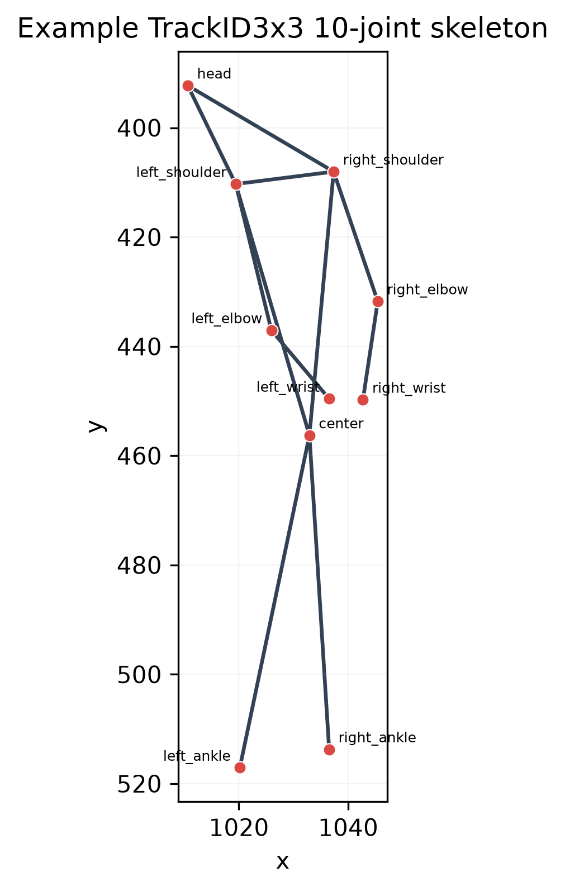

---

## 6. Bentuk data mentah dan processed

### 6.1 Nilai valid dan missing

Koordinat harus finite dan bukan pasangan persis `[0,0]`. Pasangan `[0,0]` atau nilai non-finite ditandai tidak valid melalui mask eksplisit. Nilai nol saja tidak cukup untuk membedakan koordinat sah dan missing, sehingga model selalu menerima mask.

### 6.2 Format NPZ

Artefak processed utama adalah:

```text
data/processed/trackid3x3/dataset.npz
```

Kontrak array-nya:

| Field | Tipe | Bentuk | Arti |
|---|---|---:|---|
| `coords` / `keypoints` | `float32` | `[N,T,10,2]` | koordinat pixel sumber; invalid dinolkan |
| `valid_mask` | `bool` | `[N,T,10]` | joint sumber yang valid |
| `bbox_xywh` / `bboxes` | `float32` | `[N,T,4]` | bbox sumber dalam pixel |
| `domains` | string | `[N]` | Indoor, Outdoor, atau Drone |
| `video_ids` | string | `[N]` | video atau surrogate unavailable |
| `track_ids` | string | `[N]` | identitas player/track dalam scope video |
| `frame_ids` | `int64` | `[N,T]` | ID frame sumber |
| `sequence_mask` | `bool` | `[N,T]` | timestep nyata, bukan padding |
| `sample_ids` | string | `[N]` | ID sampel/window yang stabil dan unik |
| `splits` | string | `[N]` | train, val, atau test |
| `joint_names` | string | `[10]` | urutan joint kanonis |
| `edges` | `int64` | `[E,2]` | edge graph |

Representasi dinormalisasi dibuat saat runtime. Pixel dan koordinat normalized tidak dicampur diam-diam. Metadata menyimpan commit sumber, seed, split, provenance bbox, aturan representasi, dan flag synthetic.

### 6.3 Ringkasan storage

Manifest memakai MB desimal, kecuali ukuran checkout awal yang dilaporkan dalam MiB.

| Kategori | Ukuran |
|---|---:|
| Raw annotations dan staging | 139.071479 MB |
| Processed datasets | 3.308607 MB |
| Checkpoints | 24.101907 MB |
| Figures | 63.006319 MB |
| Temporary, reports, logs, dan Git overhead | 49.747317 MB |
| **Total footprint** | **279.235629 MB** |

Target yang disukai adalah 500 MB dan hard limit adalah 600 MB. Sisa terhadap hard limit adalah sekitar 320.764 MB. Folder figure melebihi soft subtarget 30 MB karena varian lama dan berulang dipertahankan, tetapi keseluruhan proyek tetap di bawah hard limit.

---

## 7. Sampling, split, dan pencegahan data leakage

### 7.1 Subset statis T=1

Sampling memakai seed 42, stride frame 3, dan target yang ditentukan sebelumnya:

| Domain | Unit split | Group train/val/test | Instance train/val/test | Total terpilih | Frame unik |
|---|---|---:|---:|---:|---:|
| Indoor | video | 9/2/2 | 693/154/153 | 1,000 | 604 |
| Outdoor | player/track | 4/1/1 | 666/167/167 | 1,000 | 719 |
| Drone | player/track | 4/1/1 | 334/83/83 | 500 | 164 |

Total subset statis adalah 2,500 pose instance. Semua overlap group train-val, train-test, dan val-test bernilai nol.

Indoor dapat dibagi berdasarkan video karena tersedia 13 video pose. Outdoor hanya memiliki satu video pose, sehingga dibagi berdasarkan player. Drone tidak memiliki video identity yang dapat diandalkan, sehingga juga memakai player grouping.

**Mengapa split berdasarkan group penting?** Jika frame pemain atau video yang sama muncul di train dan test, model dapat memperoleh keuntungan dari kemiripan yang seharusnya tidak tersedia pada data baru. Itulah bentuk data leakage.

### 7.2 Dataset temporal T=16

Window temporal dibangun dari stream sumber sebelum random thinning. Frame maju dengan step 3. Setiap window berisi 16 pengamatan dan hop-nya juga 16 pengamatan, setara 48 source frames. Window tidak overlap dan tidak boleh melintasi video, pemain, split, atau diskontinuitas.

| Domain | Window tersedia | Window dipilih | Observasi pose | Window train/val/test |
|---|---:|---:|---:|---:|
| Indoor | 300 | 62 | 992 | 43/10/9 |
| Outdoor | 447 | 62 | 992 | 41/10/11 |
| Drone | 0 | 0 | 0 | excluded |
| **Total** | **747** | **124** | **1,984** | **84/20/20** |

Drone sengaja tidak dimasukkan karena kontinuitas video-player tidak dapat dibuktikan dari JSON pose. Hanya terdapat 20 window test temporal, sehingga hasil TCN harus dianggap tambahan, bukan bukti kuat keunggulan temporal secara umum.

---

## 8. Tugas masked-keypoint reconstruction

### 8.1 Dua jenis missing

Proyek membedakan:

1. **Natural missingness**: titik memang tidak tersedia pada anotasi sumber.
2. **Synthetic masking**: titik valid sengaja disembunyikan untuk eksperimen.

Natural missingness tidak pernah dipakai sebagai ground truth. Loss dan metrik hanya menghitung synthetic target yang awalnya valid.

### 8.2 Urutan operasi anti-leakage

Urutan berikut wajib dipertahankan:

1. Mulai dari koordinat pixel dan `original_valid_mask`.
2. Buat deterministic synthetic mask hanya pada joint sumber yang valid.
3. Hapus koordinat target tersebut sebelum membuat representasi.
4. Hitung center, scale, fallback bbox, dan sudut hanya dari joint yang masih observed.
5. Jalankan model untuk mengisi posisi yang hilang.
6. Hitung loss hanya pada synthetic target mask.
7. Inverse prediction kembali ke source pixel.
8. Hitung NMJE dan PCK menggunakan diagonal source bbox yang disimpan terpisah.

Secara ringkas:

```text
pixel pose -> pilih target valid -> sembunyikan target
           -> transform dari observed joints saja
           -> model -> inverse ke pixel -> NMJE/PCK
```

Mask dibuat deterministically dari sample ID dan seed. Dengan demikian hasil tidak berubah hanya karena urutan batch atau jumlah data-loader worker berubah.

---

## 9. Lima representasi input

Representasi adalah cara mengubah koordinat sebelum dikirim ke model.

| Representasi | Cara kerja | Cara kembali ke pixel |
|---|---|---|
| `raw` | memakai koordinat pixel sumber | identity |
| `bbox_normalized` | `(x-x0)/w` dan `(y-y0)/h` | kali `w,h`, lalu tambah `x0,y0` |
| `root_centered` | mengurangi observed-only anatomical/fallback center | tambah center |
| `scale_normalized` | center lalu bagi observed-only torso/robust scale | kali scale lalu tambah center |
| `normalized_angles` | scale-normalized x/y ditambah lima sudut sebagai konteks | hanya x/y yang di-inverse; sudut bukan target |

Normalisasi mencoba mengurangi variasi yang disebabkan ukuran pixel, posisi pemain, dan jarak kamera. Namun keberhasilan eksperimen normalisasi tidak otomatis membuktikan hubungan sebab-akibat, karena skala angka juga memengaruhi kesulitan optimisasi model.

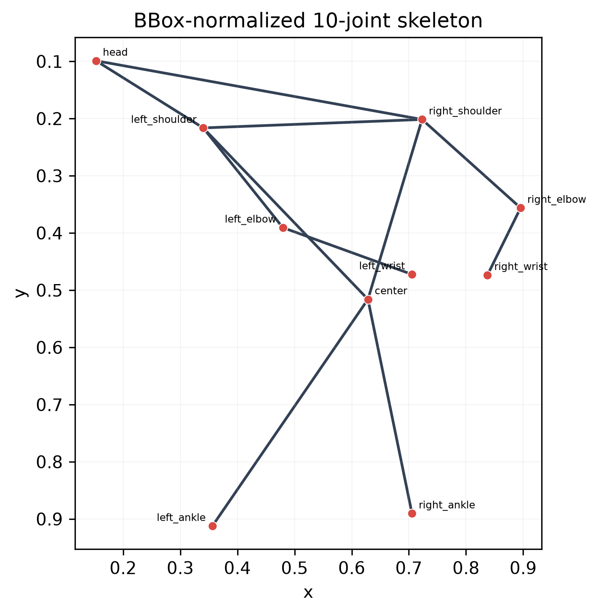

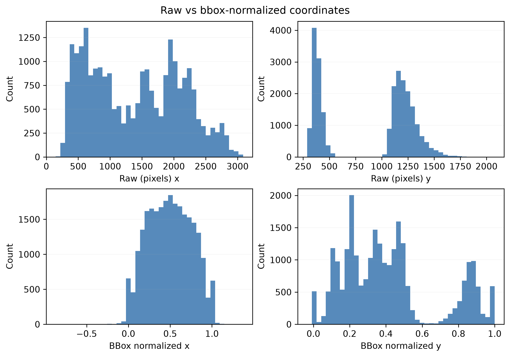

---

## 10. Model yang dibandingkan

### 10.1 Geometric baseline

Baseline geometric tidak memiliki parameter yang dipelajari. Ia menjadi titik pembanding sederhana: model neural seharusnya memberi nilai tambah terhadap heuristic yang tidak training.

### 10.2 MLP

Multi-Layer Perceptron atau MLP meratakan informasi semua 10 landmark pada satu frame, menggabungkan koordinat dan mask, lalu memprediksi koordinat yang hilang. MLP cocok sebagai baseline learned spatial yang ringkas.

### 10.3 Graph model

Graph model memperlakukan keypoint sebagai node dan 11 hubungan skeleton sebagai edge. Informasi diteruskan antar-joint yang berhubungan. Implementasi memvalidasi tepat layout TrackID3x3 dan menolak graph yang tidak sesuai. Jumlah parameter dibatasi di bawah satu juta.

### 10.4 TCN

Temporal Convolutional Network atau TCN memakai konvolusi temporal berdilasi untuk membaca perubahan pose sepanjang window. TCN hanya sah pada reliable `T=16` track windows. Menjalankan TCN pada `T=1` tidak dapat menunjukkan keuntungan temporal.

### 10.5 Controlled model comparison

Perbandingan model kanonis memakai data dan setting yang sama: bbox-normalized, `T=16`, masking 20%, 100% data, seed 42, serta equal-domain macro atas Indoor dan Outdoor.

| Model | Parameter | Checkpoint | NMJE | PCK@0.10 |
|---|---:|---:|---:|---:|
| Geometric baseline | 0 | 0 MB | 0.1562 | 0.4159 |
| Graph | 82,226 | 0.3447 MB | 0.0802 | 0.7251 |
| MLP | 26,996 | 0.1174 MB | 0.0766 | 0.7555 |
| TCN | 117,572 | 0.4872 MB | **0.0737** | **0.7686** |

TCN memiliki hasil terbaik di tabel terkontrol ini, tetapi hanya ada 20 window test. Tabel ini tidak cukup untuk menyatakan bahwa TCN selalu lebih baik.

Catatan: MLP `normalized_angles` memiliki auxiliary input dan 30,836 parameter. Angka itu tidak boleh dicampur dengan MLP bbox 26,996 parameter pada tabel `T=16` di atas.

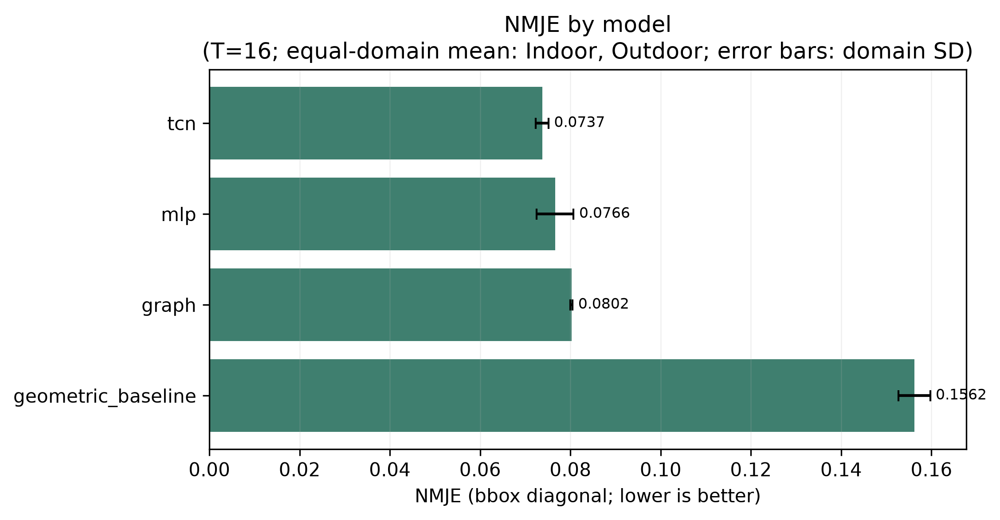

---

## 11. Proses training

Konfigurasi dasar:

- Epoch maksimum: 30.
- Optimizer: AdamW.
- Learning rate: 0.001.
- Weight decay: 0.0001.
- Early-stopping patience: 8 epoch.
- Scheduler: ReduceLROnPlateau.
- Loss: Smooth L1 pada koordinat target yang disembunyikan, beta 0.05.
- Mixed precision: aktif saat CUDA tersedia.
- Batch utama statis: 128.
- Batch controlled temporal: 32.
- Seed: 42.

Model memilih checkpoint terbaik berdasarkan performa validation. Setiap run menyimpan `best.pt`, konfigurasi yang telah di-resolve, environment, history, dan metrics.

### 11.1 Mengapa loss hanya pada target tersembunyi?

Observed joint tidak perlu ditebak ulang. Implementasi menyalin koordinat observed ke output dan menghitung loss hanya pada joint yang sengaja disembunyikan. Ini membuat objective sesuai dengan pertanyaan penelitian.

### 11.2 Bentuk umum Smooth L1

Untuk selisih koordinat `d`, Smooth L1 bersifat kuadratik di sekitar nol dan linear untuk error besar. Tujuannya memperoleh gradient yang halus tanpa terlalu sensitif terhadap outlier.

---

## 12. Metrik evaluasi

### 12.1 Error Euclidean

Untuk target joint ke-`i`:

```text
e_i = sqrt((x_pred_i - x_true_i)^2 + (y_pred_i - y_true_i)^2)
```

Nilai `e_i` masih dalam pixel.

### 12.2 Diagonal bbox

Untuk bbox dengan lebar `w` dan tinggi `h`:

```text
d_bbox = sqrt(w^2 + h^2)
```

### 12.3 NMJE

Normalized Mean Joint Error:

```text
NMJE = (1/M) * sum_i(e_i / d_bbox_i)
```

`M` adalah jumlah target joint yang benar-benar dinilai. Makin kecil NMJE, makin baik.

Contoh: bbox berukuran 60x80 memiliki diagonal 100 pixel. Jika error keypoint 10 pixel, normalized error-nya adalah `10/100 = 0.10`.

Secara kasar, NMJE `0.068` berarti rata-rata error sekitar 6.8% dari diagonal bbox untuk populasi dan agregasi yang dinyatakan. Ini bukan 6.8 pixel.

### 12.4 PCK

Percentage of Correct Keypoints pada threshold `tau`:

```text
PCK@tau = jumlah_i(e_i / d_bbox_i <= tau) / M
```

Makin besar PCK, makin baik. Proyek melaporkan PCK@0.05, PCK@0.10, dan PCK@0.20. Contoh PCK@0.10 `0.8052` berarti sekitar 80.52% target joint berada dalam jarak paling besar 10% diagonal bbox dari ground truth.

Kolom `PCK` tanpa suffix di tabel cross-domain selalu berarti PCK@0.10.

### 12.5 Micro dan macro average

Keduanya tidak dapat dipertukarkan:

- **Joint-weighted micro**: semua target joint dari semua domain digabung. Domain yang menyumbang lebih banyak joint mendapat bobot lebih besar.
- **Equal-domain macro**: hitung metric per domain, lalu rata-ratakan domain dengan bobot setara.

Contoh hasil `normalized_angles` yang sama:

| Agregasi | NMJE | PCK@0.10 | Unit |
|---|---:|---:|---|
| Joint-weighted micro | 0.06720597 | 0.80521092 | 806 target joint |
| Equal-domain macro | 0.06818125 | 0.79743851 | 3 domain |

Perbedaan kecil ini bukan kesalahan. Pertanyaan statistiknya memang berbeda.

---

## 13. Desain eksperimen

| Eksperimen | Kontrol utama | Tujuan |
|---|---|---|
| Real smoke test | 100 pose, 2 epoch | memastikan pipeline nyata berjalan |
| Representation ablation | MLP, T=1, mask 20%, data 100%, seed 42 | membandingkan lima representasi |
| Missingness robustness | normalized_angles MLP, mask 10/20/30/40% | mengukur dampak titik yang makin banyak hilang |
| Within-domain | bbox MLP, train dan test domain sama | baseline per domain |
| Cross-domain | bbox MLP, train dan test domain berbeda | menguji domain shift |
| Normalization shift | train Indoor, test Outdoor | membandingkan raw, bbox, dan scale normalization |
| Controlled model family | bbox, T=16, mask 20% | membandingkan geometric, MLP, graph, TCN |
| Data efficiency | normalized_angles MLP, requested 25/50/100% | menguji pengaruh jumlah data training |
| Error analysis | primary fixed slice | melihat pola error secara deskriptif |

Seluruh tabel perbandingan memakai slice yang dikontrol. Konfigurasi yang tidak dieksekusi tidak diisi nol dan tidak dibuatkan placeholder seolah-olah hasil nyata.

---

## 14. Hasil eksperimen

### 14.1 Representation ablation: equal-domain macro

Protokol: pooled-domain MLP, `T=1`, masking 20%, data 100%, seed 42, average setara atas Indoor, Outdoor, dan Drone.

| Representasi | NMJE | PCK@0.10 |
|---|---:|---:|
| `raw` | 8.5826 | 0.0000 |
| `bbox_normalized` | 0.0786 | 0.7507 |
| `root_centered` | 0.1400 | 0.3561 |
| `scale_normalized` | 0.0687 | 0.7974 |
| `normalized_angles` | **0.0682** | **0.7974** |

`normalized_angles` memiliki NMJE terendah pada tabel ini. Namun `scale_normalized` sangat dekat dan nilai PCK yang dibulatkan sama. Dengan satu seed, hasil ini tidak membenarkan klaim universal superiority.

### 14.2 Representation ablation: joint-weighted micro

| Representasi | NMJE | PCK@0.10 |
|---|---:|---:|
| `raw` | 8.02154955 | 0.00000000 |
| `bbox_normalized` | 0.07334749 | 0.77791563 |
| `root_centered` | 0.13703301 | 0.36228288 |
| `scale_normalized` | 0.06729583 | **0.80645161** |
| `normalized_angles` | **0.06720597** | 0.80521092 |

Pada agregasi ini, `normalized_angles` mempunyai NMJE sedikit lebih rendah, sedangkan `scale_normalized` mempunyai PCK sedikit lebih tinggi. Tidak ada satu representasi yang menang mutlak pada semua metric.

### 14.3 Robustness terhadap jumlah keypoint hilang

Equal-domain macro untuk `normalized_angles` MLP:

| Masking valid joint | NMJE | PCK@0.10 |
|---:|---:|---:|
| 10% | 0.0703 | 0.7986 |
| 20% | 0.0682 | 0.7974 |
| 30% | 0.0788 | 0.7373 |
| 40% | 0.0980 | 0.6367 |

Joint-weighted micro:

| Masking | Target joint dinilai | NMJE | PCK@0.10 |
|---:|---:|---:|---:|
| 10% | 403 | 0.06887759 | 0.80397020 |
| 20% | 806 | 0.06720597 | 0.80521092 |
| 30% | 1,209 | 0.07650274 | 0.75186104 |
| 40% | 1,612 | 0.09480598 | 0.65384615 |

Performa jelas menurun pada 30% dan 40%. Perbedaan kecil antara 10% dan 20% tidak boleh dianggap sebagai bukti bahwa menyembunyikan lebih banyak selalu membantu; hanya ada satu seed.

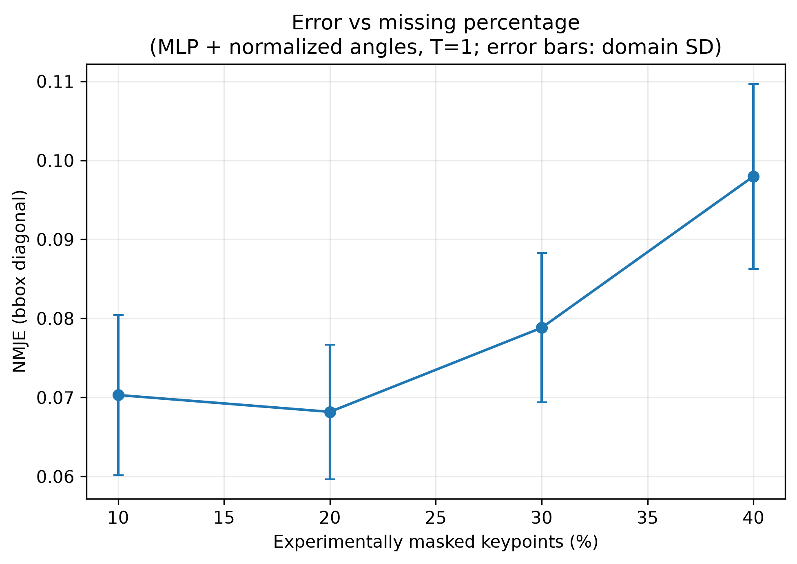

### 14.4 Within-domain

Protokol: bbox-normalized MLP statis, masking 20%, train dan test pada domain yang sama.

| Train -> test | NMJE | PCK@0.10 |
|---|---:|---:|
| Indoor -> Indoor | 0.0761 | 0.7451 |
| Outdoor -> Outdoor | **0.0677** | **0.8114** |
| Drone -> Drone | 0.0962 | 0.6566 |

Tabel di atas adalah tiga run within-domain bbox-normalized. Gambar berikut menjawab pertanyaan yang berbeda: ia memecah performa per domain dari **satu model pooled `normalized_angles`**, bukan memvisualisasikan tiga baris tabel tersebut.

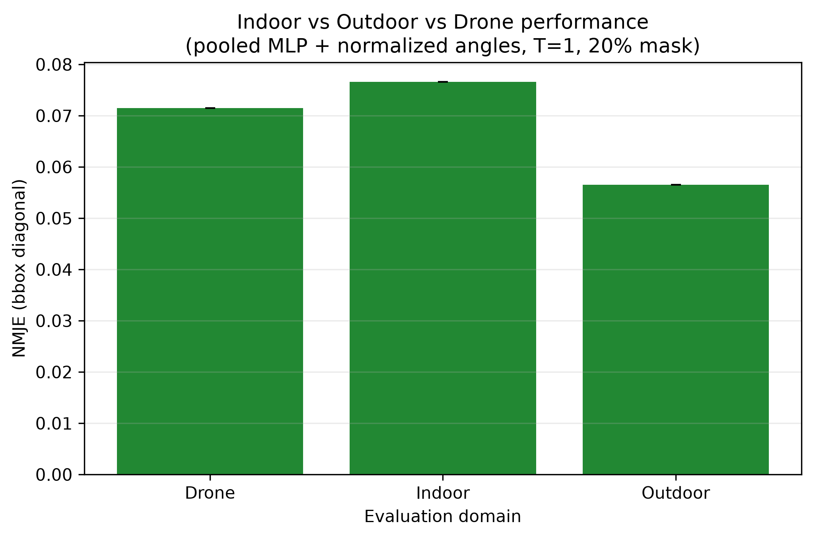

### 14.5 Cross-domain

Protokol: bbox-normalized MLP statis, masking 20%, train pada satu domain dan test pada domain lain.

| Train -> test | NMJE | PCK@0.10 |
|---|---:|---:|
| Drone -> Indoor | 0.1729 | 0.3562 |
| Drone -> Outdoor | 0.1492 | 0.4311 |
| Indoor -> Drone | 0.1399 | 0.4096 |
| Indoor -> Outdoor | **0.0688** | **0.8114** |
| Outdoor -> Drone | 0.1347 | 0.4518 |
| Outdoor -> Indoor | 0.0799 | 0.7320 |

Transfer Indoor-Outdoor relatif lebih baik daripada transfer yang melibatkan Drone. Namun Drone memakai provenance bbox yang berbeda, sehingga perbandingan langsung harus tetap disertai caveat tersebut.

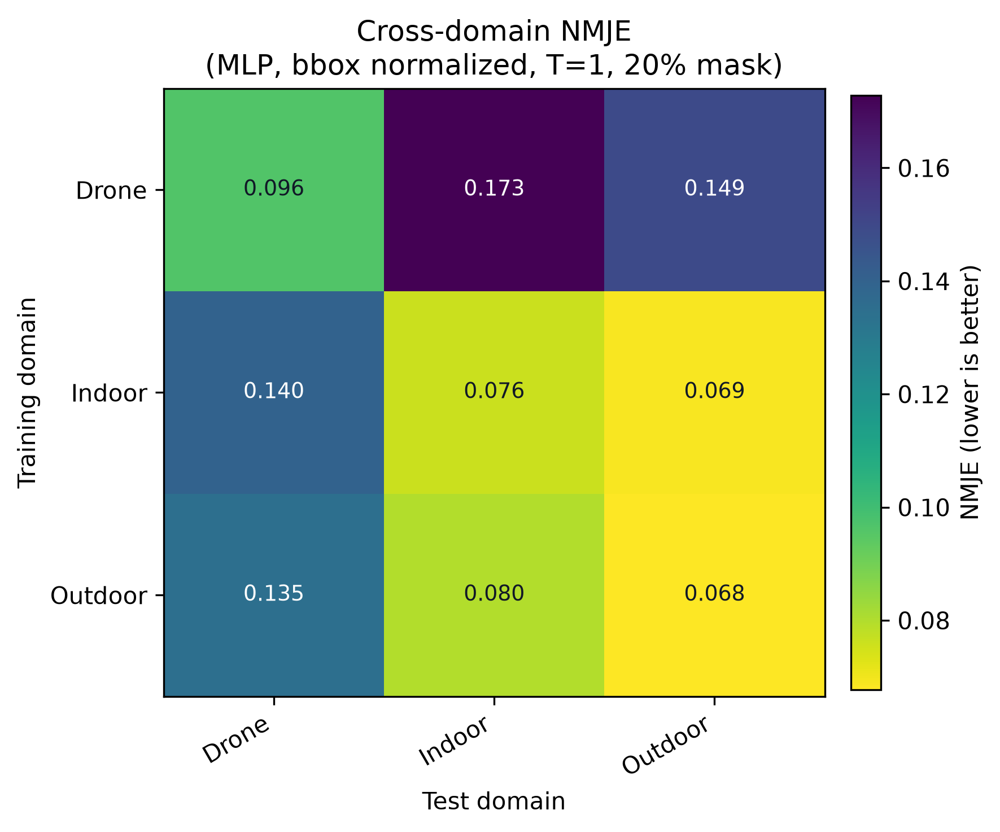

### 14.6 Normalization shift: Indoor -> Outdoor

| Representasi | NMJE | PCK@0.10 |
|---|---:|---:|
| `raw` | 8.1361 | 0.0000 |
| `bbox_normalized` | 0.0688 | 0.8114 |
| `scale_normalized` | **0.0683** | **0.8323** |

Normalisasi berkorelasi dengan hasil yang jauh lebih baik pada run ini. Gap raw juga dapat dipengaruhi skala koordinat dan kesulitan optimisasi. Hasil single-seed ini bukan bukti kausal bahwa normalisasi sendirian menyelesaikan domain shift.

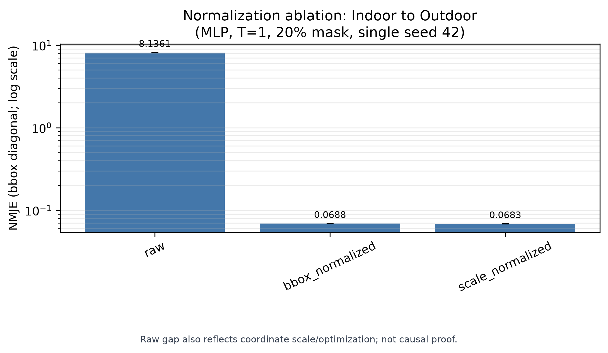

### 14.7 Data efficiency

Subset training dipilih per whole split group agar leakage tidak masuk. Akibatnya jumlah aktual tidak tepat 25% dan 50%.

| Target data | Sampel training aktual | Fraksi aktual | NMJE micro | PCK@0.10 micro |
|---:|---:|---:|---:|---:|
| 25% | 403 / 1,693 | 23.8039% | 0.07946836 | 0.73945409 |
| 50% | 884 / 1,693 | 52.2150% | 0.07293975 | 0.77047146 |
| 100% | 1,693 / 1,693 | 100.0000% | **0.06720597** | **0.80521092** |

Validation dan test partition tetap sama. Dalam tiga titik ini, penggunaan lebih banyak data training berasosiasi dengan hasil yang lebih baik. Dengan hanya tiga level dan satu seed, kurva ini belum cukup untuk membuat hukum scaling umum.

Tabel memakai **joint-weighted micro**, sedangkan kurva di bawah memakai **equal-domain mean**. Karena bobot agregasinya berbeda, angka pada tabel dan titik pada kurva tidak harus identik meskipun berasal dari slice eksperimen yang sama.

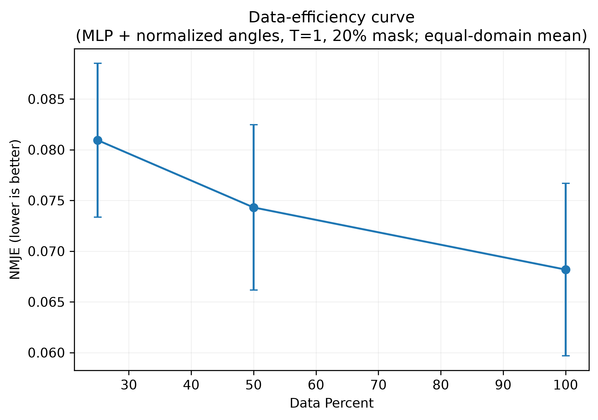

---

## 15. Interpretasi hasil

Kesimpulan yang didukung bukti:

1. Representasi normalized jauh lebih mudah dipelajari daripada pixel raw pada konfigurasi ini.
2. `normalized_angles` dan `scale_normalized` hampir seri; pilihan terbaik bergantung pada metric dan agregasi.
3. Masking 30% dan 40% menurunkan NMJE dan PCK dibanding slice 20%.
4. Transfer ke atau dari Drone lebih sulit daripada Indoor-Outdoor pada run yang ada.
5. Learned models mengungguli geometric baseline pada controlled `T=16` table.
6. TCN memperoleh angka terbaik di controlled table, tetapi bukti temporal terbatas pada 20 test windows.
7. Lebih banyak data training berasosiasi dengan performa lebih baik pada tiga titik data-efficiency yang dieksekusi.

Kesimpulan yang **tidak** didukung:

- `normalized_angles` selalu terbaik untuk semua dataset atau seed.
- TCN selalu lebih unggul daripada MLP atau graph.
- Normalisasi adalah satu-satunya penyebab peningkatan.
- Model memahami aksi basket.
- Model dapat menilai teknik atau risiko cedera.
- Error 2D ini membuktikan akurasi pose 3D.

---

## 16. Analisis error

Analisis berikut memakai slice tetap: pooled-domain `normalized_angles` MLP, `T=1`, masking 20%, data 100%, seed 42. Ini adalah pengelompokan deskriptif, bukan causal effect.

### 16.1 Berdasarkan skala pemain

| Bbox scale | Sequence | Mean NMJE |
|---|---:|---:|
| Small | 100 | 0.0844 |
| Medium | 202 | 0.0653 |
| Large | 101 | 0.0539 |

Pemain yang tampak kecil memiliki mean error lebih tinggi pada slice ini.

### 16.2 Distal target

Distal joint adalah joint yang jauh dari pusat tubuh, terutama wrist dan ankle.

| Ada distal target yang dimask | Sequence | Mean NMJE |
|---|---:|---:|
| Ya | 276 | 0.0766 |
| Tidak | 127 | 0.0468 |

### 16.3 Pose spread

| Kuartil pose spread | Sequence | Mean NMJE |
|---|---:|---:|
| Q1 | 101 | 0.0594 |
| Q2 | 101 | 0.0658 |
| Q3 | 100 | 0.0620 |
| Q4 | 101 | 0.0816 |

### 16.4 Overlap bbox pada frame yang sama

Overlap dapat dihitung langsung hanya untuk Indoor pada slice ini.

| Tingkat overlap | Sequence | Mean NMJE |
|---|---:|---:|
| Low, IoU <= 0.05 | 91 | 0.0735 |
| Moderate, 0.05 < IoU <= 0.20 | 6 | 0.0563 |
| High, IoU > 0.20 | 22 | 0.1049 |

Overlap sedang hanya memiliki enam sequence, sehingga nilainya sangat tidak stabil. Overlap tidak tersedia untuk Outdoor dan Drone pada analisis ini.

---

## 17. Gambar dan tabel yang dihasilkan

Gambar kanonis berada di:

```text
outputs/figures/reconstruction/
```

Gambar utama yang tersedia:

- `example_10_joint_skeleton.png`
- `normalized_skeleton.png`
- `dataset_domain_summary.png`
- `pose_instance_counts.png`
- `missingness_by_domain_joint.png`
- `coordinate_distributions_raw_vs_normalized.png`
- `skeleton_examples_by_domain.png`
- `error_vs_missing_percentage.png`
- `indoor_outdoor_drone_performance.png`
- `cross_domain_matrix.png`
- `normalization_ablation.png`
- `data_efficiency_curve.png`
- `nmje_by_model.png`
- `pck_curves.png`

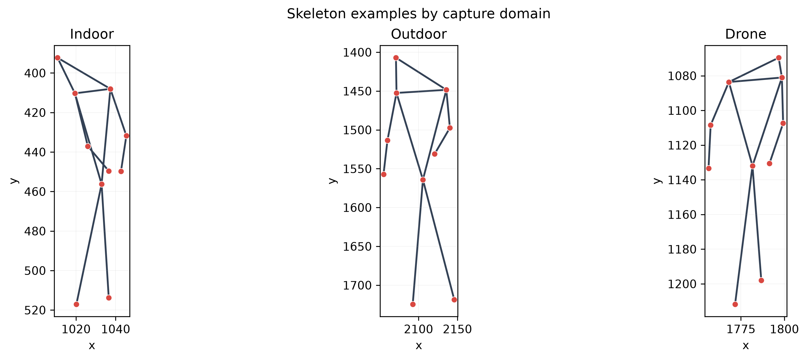

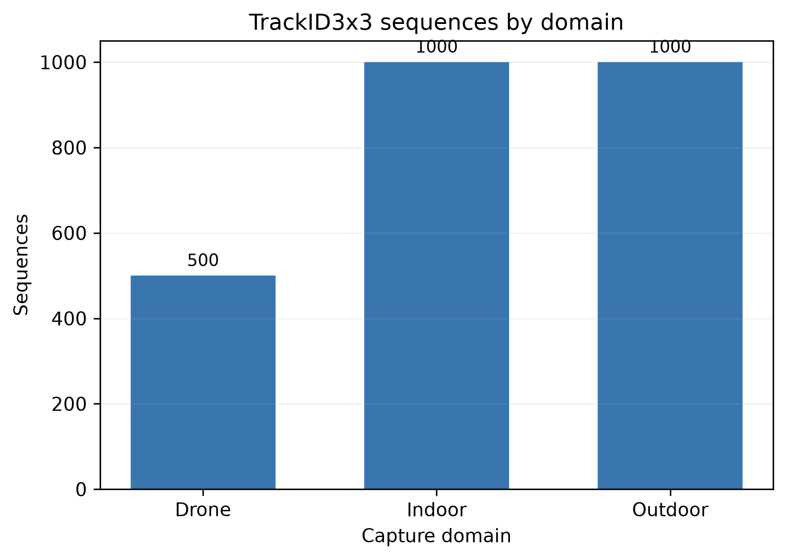

RGB overlay tidak dibuat karena source RGB tidak tersedia secara lokal dan ukuran remote media tidak diasumsikan. Ketiadaan gambar itu dicatat eksplisit; tidak diganti dengan visual sintetis.

Tabel kanonis tersedia dalam CSV dan Markdown di:

```text
outputs/tables/reconstruction/
```

Sumber tabel penting:

- `dataset_subset_statistics.csv`
- `representation_definitions.csv`
- `representation.csv`
- `model_parameters_compute.csv`
- `missing_keypoints.csv`
- `natural_missingness_by_joint.csv`
- `within_domain_metrics.csv`
- `cross_domain_metrics.csv`
- `normalization_shift.csv`
- `ablation_index.json`

`ablation_index.json` mencatat protokol, filter kontrol, dan file metric sumber. Ini membantu membedakan hasil yang dieksekusi dari konfigurasi yang belum dijalankan.

---

## 18. Cara mereproduksi proyek

Jalankan semua perintah dari root repository.

### 18.1 Prasyarat

- Python 3.11 atau lebih baru.
- Git.
- Ruang kosong minimal 1 GB sesuai storage guard.
- CUDA opsional.

Run yang ada memakai Python 3.13.5, PyTorch 2.11.0+cu128, Windows 11, dan NVIDIA GeForce RTX 3070 Ti Laptop GPU. Untuk mesin tanpa GPU, ubah `--device cuda` menjadi `--device cpu`.

Instal dependensi:

```powershell
python -m pip install -r requirements.txt
```

### 18.2 Akuisisi dan audit sumber

Mulai dengan dry run:

```powershell
python scripts/download_dataset.py --dry-run
python scripts/download_dataset.py --destination external/TrackID3x3
python scripts/inspect_dataset.py --input external/TrackID3x3 --output outputs/reports/trackid3x3_schema.md --minimum-association-dominance 0.80
```

Clone yang sudah tervalidasi akan dipakai ulang. Script tidak mengikuti link Google Drive dan tidak mengambil video atau weight besar.

### 18.3 Bangun subset statis

```powershell
python scripts/build_subset.py --input external/TrackID3x3 --output data/processed/trackid3x3/subset_manifest.csv --metadata-output data/processed/trackid3x3/subset_metadata.json --audit-output outputs/reports/split_audit.md --seed 42 --stride 3 --indoor-target 1000 --outdoor-target 1000 --drone-target 500 --minimum-association-dominance 0.80
python scripts/data_budget.py --samples 2500 --sequence-length 1 --output-dir data/processed/trackid3x3 --max-artifact-mb 600 --max-dataset-mb 600 --minimum-free-mb 1024 --json-output outputs/reports/data_budget_t1.json
python scripts/preprocess.py --input external/TrackID3x3 --manifest data/processed/trackid3x3/subset_manifest.csv --output-dir data/processed/trackid3x3 --sequence-length 1 --frame-step 3 --mask-rate 0.30 --seed 42 --indoor-observation-cap 1000 --outdoor-observation-cap 1000 --drone-observation-cap 500 --max-artifact-mb 600 --max-dataset-mb 600 --minimum-free-mb 1024 --minimum-association-dominance 0.80
```

Mask rate preprocessing adalah metadata/default artifact. Eksperimen membuat deterministic mask runtime sesuai `--mask-ratio`, sehingga run utama tetap memakai 20%.

### 18.4 Bangun supplement temporal

```powershell
python scripts/data_budget.py --samples 124 --sequence-length 16 --output-dir data/processed/trackid3x3_t16 --max-artifact-mb 600 --max-dataset-mb 600 --minimum-free-mb 1024 --json-output outputs/reports/data_budget_t16.json
python scripts/preprocess.py --input external/TrackID3x3 --output-dir data/processed/trackid3x3_t16 --sequence-length 16 --frame-step 3 --mask-rate 0.20 --seed 42 --indoor-observation-cap 1000 --outdoor-observation-cap 1000 --drone-observation-cap 0 --max-artifact-mb 600 --max-dataset-mb 600 --minimum-free-mb 1024 --minimum-association-dominance 0.80
```

### 18.5 Reproduksi primary normalized-angles run

Training:

```powershell
python scripts/train.py --config config/trackid3x3.yaml --processed data/processed/trackid3x3/dataset.npz --model mlp --representation normalized_angles --mask-ratio 0.20 --domain all --train-fraction 1.0 --epochs 30 --batch-size 128 --num-workers 0 --seed 42 --device cuda --experiment-name core_mlp_angles_all_mask20_seed42
```

Evaluasi seluruh missingness level:

```powershell
python scripts/evaluate.py --processed data/processed/trackid3x3/dataset.npz --checkpoint outputs/checkpoints/core_mlp_angles_all_mask20_seed42/best.pt --mask-ratios 0.10 0.20 0.30 0.40 --primary-mask-ratio 0.20 --split test --test-domain all --seed 42 --batch-size 256 --device cuda --output-dir outputs/logs/evaluations --figures-dir outputs/figures/core --run-name core_mlp_angles_all_mask20_seed42_eval
```

### 18.6 Reproduksi controlled T=16 TCN

```powershell
python scripts/train.py --config config/trackid3x3.yaml --processed data/processed/trackid3x3_t16/dataset.npz --model tcn --representation bbox_normalized --mask-ratio 0.20 --domain all --train-fraction 1.0 --epochs 30 --batch-size 32 --num-workers 0 --seed 42 --device cuda --experiment-name core_tcn_bbox_all_t16_mask20_seed42
python scripts/evaluate.py --processed data/processed/trackid3x3_t16/dataset.npz --checkpoint outputs/checkpoints/core_tcn_bbox_all_t16_mask20_seed42/best.pt --mask-ratios 0.20 --primary-mask-ratio 0.20 --split test --test-domain all --seed 42 --batch-size 64 --device cuda --output-dir outputs/logs/evaluations --figures-dir outputs/figures/supplemental --run-name core_tcn_bbox_all_t16_mask20_seed42_eval
```

MLP, graph, dan geometric baseline harus dijalankan pada processed `T=16` yang sama untuk mengisi controlled model table. Perintah lengkap setiap cell tersedia di root `README.md`, bagian **Temporal supplement**.

### 18.7 Reproduksi cross-domain

Checkpoint domain-specific perlu dilatih lebih dahulu. Contoh Indoor:

```powershell
python scripts/train.py --config config/trackid3x3.yaml --processed data/processed/trackid3x3/dataset.npz --model mlp --representation bbox_normalized --mask-ratio 0.20 --domain Indoor --train-fraction 1.0 --epochs 30 --batch-size 64 --num-workers 0 --seed 42 --device cuda --experiment-name domain_mlp_bbox_indoor_mask20_seed42
python scripts/run_cross_domain.py --processed data/processed/trackid3x3/dataset.npz --checkpoints-root outputs/checkpoints/domain_mlp_bbox_indoor_mask20_seed42 --domains Outdoor Drone --models mlp --representations bbox_normalized --mask-ratios 0.20 --seed 42 --batch-size 256 --device cuda --output-dir outputs/logs/cross_domain/indoor_source --figures-dir outputs/figures/domain/indoor_source --tables-dir outputs/tables/cross_domain/indoor_source --no-save-predictions
```

Ulangi dengan checkpoint Outdoor dan Drone untuk matriks enam cell. Perintah persis seluruh source domain tersedia di `README.md`, bagian **Within-domain and required cross-domain transfer**.

### 18.8 Agregasi, laporan, storage, dan quality gate

```powershell
python scripts/run_ablation.py --logs-root outputs/logs --data data/processed/trackid3x3/dataset.npz --tables-dir outputs/tables/reconstruction --figures-dir outputs/figures/reconstruction
python scripts/generate_report.py --project-root . --output outputs/reports/final_report.md
python scripts/generate_project_guide_pdf.py --source docs/PANDUAN_PROYEK.md --output output/pdf/panduan_proyek_basketball_pose.pdf
python scripts/report_storage.py --project-root . --output outputs/reports/storage_manifest.csv --json-output outputs/reports/storage_manifest.json
python scripts/cleanup.py --project-root .
python scripts/quality_gate.py --require-real-results
python -m pytest
```

`cleanup.py` hanya dry run kecuali flag `--confirm` diberikan. Jangan memakai `--confirm` tanpa memeriksa target yang akan dihapus.

### 18.9 Membaca hasil

- Checkpoint: `outputs/checkpoints/<experiment>/best.pt`
- Riwayat training: `outputs/logs/<experiment>/history.csv`
- Metric training: `outputs/logs/<experiment>/metrics.json`
- Metric evaluasi: `outputs/logs/evaluations/<run>/.../metrics.json`
- Tabel: `outputs/tables/reconstruction/`
- Figure: `outputs/figures/reconstruction/`
- Laporan: `outputs/reports/final_report.md`
- Audit schema: `outputs/reports/trackid3x3_schema.md`
- Audit split: `outputs/reports/split_audit.md`

---

## 19. Keterbatasan

1. **Single seed.** Semua comparison utama memakai seed 42 dan satu run per cell. Tidak ada confidence interval atau estimasi variansi multi-seed.
2. **Annotation-only.** RGB tidak tersedia lokal. RGB overlay dan kesimpulan berbasis appearance tidak dapat dibuat.
3. **2D, bukan 3D.** NMJE/PCK mengukur rekonstruksi anotasi 2D yang ditahan, bukan akurasi dunia 3D.
4. **Drone bbox provenance berbeda.** Drone memakai full-pose tight bbox hanya sebagai denominator metrik; Indoor/Outdoor memakai bbox MOT independen. Perbandingan Drone tidak sepenuhnya identik dalam provenance.
5. **Drone tidak temporal.** Tidak ada video identity yang cukup andal untuk window Drone.
6. **Dataset temporal kecil.** Hanya 124 window `T=16` dan 20 test windows.
7. **Sedikit split group.** Outdoor dan Drone masing-masing hanya enam player groups.
8. **Natural missing tidak diprediksi sebagai ground truth.** Hanya synthetic target yang awalnya valid dinilai.
9. **Tidak ada label aksi.** Proyek tidak boleh membuat klaim action recognition.
10. **Tidak ada klaim biomekanik.** Hasil tidak menilai teknik bermain atau risiko cedera.
11. **Normalisasi bukan bukti kausal.** Gap raw juga berkaitan dengan skala koordinat dan optimisasi.
12. **Data-efficiency hanya tiga titik.** Whole-group sampling menghasilkan fraksi aktual 23.8039%, 52.2150%, dan 100%.
13. **Error strata bersifat deskriptif.** Perbedaan small/large, distal/non-distal, atau overlap tidak membuktikan penyebab.
14. **Soft storage target figure terlampaui.** Figure 63.006319 MB lebih besar dari target 30 MB, tetapi total 279.235629 MB tetap jauh di bawah hard cap 600 MB.

---

## 20. Glosarium

| Istilah | Penjelasan sederhana |
|---|---|
| Annotation | Informasi ground truth yang ditambahkan pada data, misalnya koordinat keypoint. |
| Annotation-only | Akuisisi yang hanya berisi anotasi, tanpa media RGB. |
| Keypoint / joint / landmark | Titik anatomi pada pose. |
| Skeleton | Keypoint beserta garis atau edge penghubungnya. |
| Pose instance | Pose satu pemain pada satu frame. |
| Pixel coordinate | Posisi `[x,y]` pada grid gambar. |
| Bounding box / bbox | Kotak yang mengelilingi objek atau pemain. |
| `xywh` | Format bbox: x, y, width, height. |
| Domain | Kondisi sumber data, seperti Indoor, Outdoor, atau Drone. |
| Domain shift | Perubahan distribusi akibat kamera, viewpoint, resolusi, atau kondisi lain. |
| Frame | Satu gambar dalam video. |
| Track | Urutan pengamatan identitas yang sama. |
| Sequence / window | Potongan pengamatan temporal. |
| `T=1` | Satu pose tanpa konteks waktu. |
| `T=16` | Window dengan 16 pengamatan pose. |
| Tensor | Array multidimensi untuk data dan komputasi model. |
| Valid mask | Penanda joint yang tersedia secara alami. |
| Synthetic mask | Penanda joint valid yang sengaja disembunyikan. |
| Observed mask | Joint yang masih terlihat setelah masking. |
| Natural missingness | Titik yang memang hilang pada anotasi sumber. |
| Target | Nilai yang harus diprediksi model. |
| Feature / representation | Bentuk numerik input yang diberikan ke model. |
| Normalization | Transformasi agar skala/posisi input lebih konsisten. |
| Inverse transform | Mengembalikan output normalized ke pixel sumber. |
| Auxiliary angle | Fitur sudut tambahan; konteks, bukan target koordinat. |
| Data leakage | Informasi train/target yang tidak semestinya masuk ke test atau input. |
| Train split | Data untuk mempelajari parameter model. |
| Validation split | Data untuk memilih checkpoint/hyperparameter. |
| Test split | Data held-out untuk evaluasi akhir. |
| Group-disjoint | Tidak ada video/player group yang sama di dua split. |
| Seed | Angka awal random generator agar proses dapat diulang. |
| Deterministic | Input dan seed sama menghasilkan keputusan yang sama. |
| Stride / frame step | Jarak frame sumber yang diambil. |
| Hop | Jarak antara awal dua temporal window. |
| Baseline | Metode pembanding sederhana. |
| MLP | Neural network dengan fully connected layers. |
| Graph model | Model yang memakai keypoint sebagai node dan skeleton sebagai edge. |
| TCN | Temporal Convolutional Network untuk sequence. |
| Parameter | Nilai model yang dipelajari saat training. |
| Checkpoint | Snapshot parameter model yang disimpan. |
| Epoch | Satu putaran training melalui data training. |
| Batch | Sekelompok sampel yang diproses bersama. |
| Optimizer | Algoritma yang memperbarui parameter, di sini AdamW. |
| Learning rate | Besar langkah update optimizer. |
| Loss | Nilai objective yang diminimalkan saat training. |
| Smooth L1 | Loss yang halus dekat nol dan lebih tahan outlier daripada MSE. |
| Inference | Menggunakan model terlatih untuk menghasilkan prediction. |
| Ablation | Eksperimen yang mengganti satu faktor sambil menjaga faktor lain tetap. |
| Within-domain | Train dan test pada domain yang sama. |
| Cross-domain | Train pada satu domain dan test pada domain lain. |
| NMJE | Mean joint error yang dibagi diagonal bbox; lebih kecil lebih baik. |
| PCK | Proporsi keypoint di bawah threshold error; lebih besar lebih baik. |
| Threshold | Batas yang menentukan prediction dianggap benar. |
| Per-joint error | Error yang dipisah berdasarkan nama joint. |
| Micro average | Menggabungkan semua target joint sebelum menghitung rata-rata. |
| Macro average | Menghitung per domain lalu memberi setiap domain bobot setara. |
| CUDA / GPU | Teknologi komputasi paralel untuk mempercepat training. |
| Mixed precision | Pemakaian presisi numerik campuran untuk efisiensi GPU. |
| JSON | Format teks untuk anotasi sumber. |
| MOT | Format anotasi tracking multi-object. |
| NPZ | Arsip NumPy terkompresi untuk array processed. |
| CSV | Tabel teks comma-separated. |
| YAML | Format konfigurasi yang mudah dibaca. |
| Provenance | Catatan asal dan cara suatu nilai diperoleh. |
| Synthetic fixture | Data buatan untuk pengujian software, bukan hasil penelitian. |
| Exploratory result | Hasil awal untuk eksplorasi, belum bukti konfirmatori. |
| Confidence interval | Rentang ketidakpastian statistik; belum tersedia dari single-seed run ini. |

---

## 21. Sumber, lisensi, dan sitasi

Sumber internal yang paling otoritatif:

- `README.md`: workflow dan command eksperimen.
- `outputs/reports/final_report.md`: laporan hasil dan audit figure.
- `outputs/reports/trackid3x3_schema.md`: schema dan hitungan sumber.
- `outputs/reports/split_audit.md`: bukti split dan window temporal.
- `docs/PROCESSED_FORMAT.md`: kontrak NPZ.
- `config/joint_mapping.yaml`: mapping, edge, dan sudut.
- `outputs/tables/reconstruction/`: tabel hasil kanonis.
- `outputs/reports/storage_manifest.csv`: accounting storage.
- `CITATION.cff`: metadata sitasi.

Referensi dataset/paper:

> K. Yamada, L. Yin, Q. Hu, N. Ding, S. Iwashita, J. Ichikawa, K. Kotani, C. Yeung, dan K. Fujii. "TrackID3x3: A Dataset and Algorithm for Multi-Player Tracking with Identification and Pose Estimation in 3x3 Basketball Full-court Videos." 2025. DOI: `10.1145/3728423.3759400`.

Repositori menyatakan original TrackID3x3 code menggunakan Apache-2.0 dan dataset menggunakan CC BY 4.0 kecuali dinyatakan lain. Direktori pihak ketiga tetap mengikuti lisensinya masing-masing.

---

## Ringkasan akhir

Proyek ini berhasil membangun pipeline annotation-only yang reproducible untuk masked-keypoint reconstruction pada tiga domain TrackID3x3. Pipeline menjaga split group-disjoint, memisahkan natural dan synthetic missingness, menutup jalur leakage pada transform Drone, membandingkan lima representasi dan empat keluarga model, serta menghasilkan metric dan visual yang berasal dari run nyata.

Hasil terbaik tidak boleh diringkas hanya sebagai satu angka tanpa konteks. Pernyataan yang tepat adalah:

> Dalam comparison MLP `T=1`, mask 20%, data 100%, seed 42, dan equal-domain macro atas Indoor, Outdoor, dan Drone, `normalized_angles` memperoleh NMJE 0.06818125 dan PCK@0.10 0.79743851. Hasil joint-weighted micro untuk slice yang sama adalah NMJE 0.06720597 dan PCK@0.10 0.80521092 pada 806 target joint. Bukti ini single-seed dan eksploratif.
